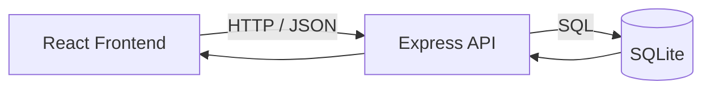
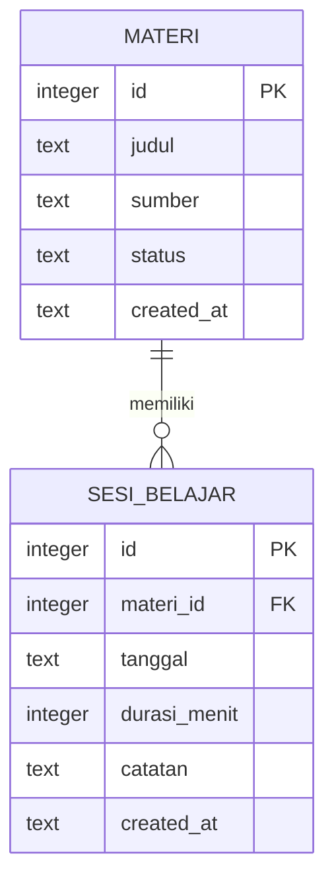

<div align="center">

# Catatan Belajar Ngoding

**ifs24024-pabwe2026-p1**

**Catat materi, rekam sesi belajar, dan pantau progres ngodingmu dalam satu aplikasi.**


</div>

---

## Daftar Isi

- [Informasi Proyek](#informasi-proyek)
- [Tentang Proyek](#tentang-proyek)
- [Status Pengembangan](#status-pengembangan)
- [Fitur Utama](#fitur-utama)
- [Teknologi](#teknologi)
- [Arsitektur Sistem](#arsitektur-sistem)
- [Struktur Proyek](#struktur-proyek)
- [Rute Aplikasi](#rute-aplikasi)
- [Desain Database](#desain-database)
- [Referensi API](#referensi-api)
- [Memulai](#memulai)
- [Konfigurasi Lingkungan](#konfigurasi-lingkungan)
- [Pengujian](#pengujian)
- [Deployment](#deployment)
- [Praktik Terbaik yang Diterapkan](#praktik-terbaik-yang-diterapkan)

---

## Informasi Proyek

| Informasi | Keterangan |
| --- | --- |
| Nama repositori | `ifs24024-pabwe2026-p1` |
| Mata kuliah | Pengembangan Aplikasi Berbasis Web (PABWE) 2026 |
| Jenis tugas | Proyek 1 (individu) |
| Nama mahasiswa | Lyson Paulus Esar Manik |
| NIM | 11S24024 |

### Tautan Penting

| Artefak | Tautan |
| --- | --- |
| Aplikasi (frontend) | `<isi URL aplikasi>` |
| API (backend) | `<isi URL API>` |
| Video YouTube | `<isi URL video>` |
| Hasil pengujian deployment | `<isi URL atau lampiran>` |
| Dokumen Proyek 1 | `<isi tautan dokumen>` |

---

## Tentang Proyek

Belajar pemrograman membutuhkan konsistensi. **Catatan Belajar Ngoding** membantu menjaga konsistensi itu: pengguna mencatat materi yang sedang dipelajari (misalnya dari kursus daring atau buku), merekam setiap sesi belajar, lalu memantau progres lewat status materi dan total menit belajar.

Aplikasi terdiri dari dua bagian yang dipisahkan dengan jelas:

| Bagian | Peran | Teknologi |
| --- | --- | --- |
| **Backend** | REST API yang menyediakan data sendiri | Express.js dan SQLite |
| **Frontend** | Antarmuka yang mengonsumsi API | React, Vite, dan Tailwind CSS |

Pada kedua sisi, tanggung jawab dipisahkan secara tegas, input divalidasi berlapis, error ditangani secara terpusat, dan hasil kerja diverifikasi dengan pengujian otomatis.

---

## Status Pengembangan

| Komponen | Status | Keterangan |
| --- | --- | --- |
| Backend API | Selesai | 8 endpoint, 16 skenario pengujian lulus, coverage sekitar 95% |
| Database SQLite | Selesai | Dua tabel berelasi, dibuat otomatis saat server berjalan |
| Dokumentasi | Selesai | README, referensi API, dan desain database |
| Frontend React | Dalam pengerjaan | Mengikuti struktur dan rute pada dokumen ini |
| Pipeline CI/CD | Menyusul | Jenkins dan SonarQube akan ditambahkan kemudian |

---

## Fitur Utama

### Manajemen Materi
- Menambah, melihat, mengubah, dan menghapus materi belajar
- Status materi: `belum`, `sedang`, `selesai`
- Total menit belajar dihitung otomatis pada setiap materi
- Pencarian langsung (*live search*) dan penyaringan berdasarkan status *(frontend)*

### Sesi Belajar
- Mencatat sesi pada materi tertentu: tanggal, durasi dalam menit, dan catatan
- Riwayat sesi belajar per materi
- Menghapus sesi belajar
- Sesi ikut terhapus otomatis ketika materinya dihapus

### Ringkasan Progres *(frontend)*
- Jumlah materi, materi yang sudah selesai, dan total waktu belajar pada halaman utama

### Keandalan dan Antarmuka
- Validasi input di backend; form frontend divalidasi sebelum dikirim
- Response API seragam dengan pesan error yang jelas
- Dialog konfirmasi hapus dan notifikasi dengan SweetAlert2 *(frontend)*
- Indikator loading, tampilan data kosong, dan desain responsif *(frontend)*

> Fitur bertanda *(frontend)* tersedia setelah bagian frontend selesai, sesuai tabel [Status Pengembangan](#status-pengembangan).

---

## Teknologi

| Kategori | Teknologi |
| --- | --- |
| Package manager dan script runner | [Bun](https://bun.sh) |
| Runtime server dan pengujian | Node.js 20 LTS |
| Backend | Express.js |
| Database | SQLite (`better-sqlite3`) |
| Frontend | React, Vite |
| Routing | React Router |
| Styling | Tailwind CSS v4 (`@tailwindcss/vite`) |
| Ikon | `react-icons` |
| Dialog dan notifikasi | SweetAlert2 |
| Pengujian | Vitest, Supertest, Testing Library, jsdom, `@vitest/coverage-v8` |

> **Catatan pemakaian Bun dan Node.js:** Bun dipakai untuk `bun install` dan menjalankan script. Server backend dan pengujian tetap berjalan di Node.js karena `better-sqlite3` adalah modul native yang paling stabil di Node.js.

---

## Arsitektur Sistem

Frontend tidak pernah mengakses database secara langsung. Seluruh data melalui API.



### Backend

`Route -> Controller -> Service -> Repository -> Database`

| Lapisan | Tanggung jawab |
| --- | --- |
| Route | Menentukan endpoint |
| Controller | Menerima request dan mengirim response |
| Service | Aturan bisnis dan validasi |
| Repository | Satu-satunya tempat query SQL |
| Middleware | Penanganan error terpusat dan response seragam |

### Frontend

`Page -> Hook -> Service -> API Client -> API`

| Lapisan | Tanggung jawab |
| --- | --- |
| Pages dan Components | Tampilan |
| Hooks | Pengelolaan state dan alur pengambilan data |
| Services | Satu-satunya tempat pemanggilan endpoint |
| Helpers | Pembungkus `fetch` dan dialog SweetAlert2 |
| Utils | Fungsi murni seperti validasi dan pemformatan |
| Lib | Konstanta konfigurasi terpusat |

---

## Struktur Proyek

```text
ifs24024-pabwe2026-p1/
├── backend/
│   ├── src/
│   │   ├── config/                   # Koneksi database dan environment
│   │   │   ├── database.js
│   │   │   └── env.js
│   │   ├── controllers/
│   │   │   ├── materi.controller.js
│   │   │   └── sesi.controller.js
│   │   ├── services/                 # Aturan bisnis dan validasi
│   │   │   ├── materi.service.js
│   │   │   └── sesi.service.js
│   │   ├── repositories/             # Query SQL
│   │   │   ├── materi.repository.js
│   │   │   └── sesi.repository.js
│   │   ├── routes/
│   │   │   ├── index.js
│   │   │   ├── materi.routes.js
│   │   │   └── sesi.routes.js
│   │   ├── middlewares/
│   │   │   └── error-handler.js      # Penanganan error terpusat
│   │   ├── utils/
│   │   │   ├── app-error.js
│   │   │   ├── parse-id.js
│   │   │   └── response.js
│   │   ├── app.js                    # Konfigurasi aplikasi Express
│   │   └── server.js                 # Titik masuk server
│   ├── tests/
│   │   └── api.test.js
│   ├── vitest.config.js
│   ├── .env.example
│   ├── bun.lock
│   └── package.json
│
├── frontend/
│   ├── src/
│   │   ├── features/
│   │   │   ├── materi/
│   │   │   │   ├── components/       # MateriCard, MateriForm, MateriList, MateriFilter
│   │   │   │   ├── hooks/            # useMateri
│   │   │   │   ├── pages/            # MateriListPage, MateriDetailPage
│   │   │   │   └── services/         # materiService
│   │   │   └── sesi/
│   │   │       ├── components/       # SesiForm, SesiList
│   │   │       ├── hooks/            # useSesi
│   │   │       └── services/         # sesiService
│   │   ├── components/
│   │   │   ├── common/               # Button, Loading, ErrorMessage, EmptyState
│   │   │   └── layout/               # MainLayout, Navbar
│   │   ├── pages/
│   │   │   └── NotFoundPage.jsx
│   │   ├── helpers/
│   │   │   ├── apiClient.js          # Pembungkus fetch
│   │   │   └── dialogHelper.js       # Dialog SweetAlert2
│   │   ├── hooks/
│   │   │   └── useInput.js           # Hook binding form
│   │   ├── lib/
│   │   │   └── config.js             # Konstanta konfigurasi terpusat
│   │   ├── utils/
│   │   │   ├── validators.js
│   │   │   └── formatters.js
│   │   ├── App.jsx                   # Definisi rute
│   │   ├── main.jsx
│   │   ├── index.css                 # Konfigurasi Tailwind CSS v4
│   │   ├── setupTests.js             # Setup Vitest + jest-dom
│   │   └── test-utils.jsx            # Helper render dengan router
│   ├── tests/
│   ├── vite.config.js
│   ├── vitest.config.js
│   ├── .env.example
│   └── package.json
│
├── .gitignore
└── README.md
```

---

## Rute Aplikasi

| Rute | Halaman | Akses |
| --- | --- | --- |
| `/` | Daftar materi dan ringkasan progres | Publik |
| `/materi/:id` | Detail materi dan riwayat sesi belajar | Publik |
| `*` | Halaman tidak ditemukan | Publik |

---

## Desain Database

Satu materi memiliki banyak sesi belajar.



| Tabel | Aturan penting |
| --- | --- |
| `materi` | `judul` wajib; `status` hanya `belum`, `sedang`, atau `selesai` (bawaan `belum`) |
| `sesi_belajar` | `durasi_menit` harus lebih dari 0; terhubung ke `materi` dengan `ON DELETE CASCADE` |

```sql
CREATE TABLE IF NOT EXISTS materi (
  id          INTEGER PRIMARY KEY AUTOINCREMENT,
  judul       TEXT NOT NULL,
  sumber      TEXT,
  status      TEXT NOT NULL DEFAULT 'belum'
              CHECK (status IN ('belum', 'sedang', 'selesai')),
  created_at  TEXT NOT NULL DEFAULT CURRENT_TIMESTAMP
);

CREATE TABLE IF NOT EXISTS sesi_belajar (
  id            INTEGER PRIMARY KEY AUTOINCREMENT,
  materi_id     INTEGER NOT NULL,
  tanggal       TEXT NOT NULL,
  durasi_menit  INTEGER NOT NULL CHECK (durasi_menit > 0),
  catatan       TEXT,
  created_at    TEXT NOT NULL DEFAULT CURRENT_TIMESTAMP,
  FOREIGN KEY (materi_id) REFERENCES materi(id) ON DELETE CASCADE
);
```

---

## Referensi API

Base URL lokal: `http://localhost:3000/api`

Format response berhasil:

```json
{ "success": true, "message": "Materi berhasil dibuat", "data": {} }
```

Format response gagal:

```json
{ "success": false, "message": "Input tidak valid", "errors": ["judul wajib diisi"] }
```

**Coba cepat dengan `curl`:**

```bash
# Membuat materi
curl -X POST http://localhost:3000/api/materi \
  -H "Content-Type: application/json" \
  -d '{"judul":"JavaScript Dasar","sumber":"SoloLearn","status":"sedang"}'

# Menambah sesi belajar pada materi dengan id 1
curl -X POST http://localhost:3000/api/materi/1/sesi \
  -H "Content-Type: application/json" \
  -d '{"tanggal":"2026-10-24","durasi_menit":45,"catatan":"Perulangan dan fungsi"}'

# Melihat semua materi beserta total menit belajar
curl http://localhost:3000/api/materi
```

<details>
<summary><b>Materi</b></summary>

| Method | Endpoint | Deskripsi |
| --- | --- | --- |
| `GET` | `/materi` | Semua materi beserta total menit belajar |
| `GET` | `/materi/:id` | Detail satu materi |
| `POST` | `/materi` | Membuat materi |
| `PUT` | `/materi/:id` | Mengubah materi |
| `DELETE` | `/materi/:id` | Menghapus materi beserta seluruh sesinya |

Body `POST` dan `PUT`:

| Field | Tipe | Aturan |
| --- | --- | --- |
| `judul` | string | Wajib, maksimal 100 karakter |
| `sumber` | string | Opsional, maksimal 100 karakter |
| `status` | string | Opsional: `belum` (bawaan), `sedang`, `selesai` |

</details>

<details>
<summary><b>Sesi Belajar</b></summary>

| Method | Endpoint | Deskripsi |
| --- | --- | --- |
| `GET` | `/materi/:materiId/sesi` | Semua sesi pada suatu materi |
| `POST` | `/materi/:materiId/sesi` | Menambah sesi belajar |
| `DELETE` | `/sesi/:id` | Menghapus satu sesi |

Body `POST`:

| Field | Tipe | Aturan |
| --- | --- | --- |
| `tanggal` | string | Wajib, format `YYYY-MM-DD` dan tanggal yang valid |
| `durasi_menit` | integer | Wajib, antara 1 dan 1440 |
| `catatan` | string | Opsional, maksimal 500 karakter |

</details>

<details>
<summary><b>Utilitas</b></summary>

| Method | Endpoint | Deskripsi |
| --- | --- | --- |
| `GET` | `/health` | Pemeriksaan status API |

</details>

<details>
<summary><b>Kode status HTTP</b></summary>

| Kode | Arti |
| --- | --- |
| `200` | Permintaan berhasil |
| `201` | Data berhasil dibuat |
| `400` | Input tidak valid |
| `404` | Data tidak ditemukan |
| `500` | Kesalahan pada server |

</details>

---

## Memulai

### Prasyarat

- [Bun](https://bun.sh) terbaru
- Node.js 20 LTS atau lebih baru
- Git

### Instalasi

Langkah berikut sesuai dengan alur pada video demonstrasi.

```bash
git clone https://github.com/<username-github>/ifs24024-pabwe2026-p1.git
cd ifs24024-pabwe2026-p1
```

### Menjalankan Backend

```bash
cd backend
bun install
cp .env.example .env
bun run dev
```

Backend berjalan di `http://localhost:3000`. Database dan tabel dibuat otomatis saat server pertama kali dijalankan. Periksa dengan membuka `http://localhost:3000/api/health`.

### Menjalankan Frontend

Buka terminal baru:

```bash
cd frontend
bun install
cp .env.example .env
bun run dev
```

Buka `http://localhost:5173` pada peramban.

### Perintah yang Tersedia

| Lokasi | Perintah | Fungsi |
| --- | --- | --- |
| backend | `bun run dev` | Server mode pengembangan (muat ulang otomatis) |
| backend | `bun run start` | Server untuk produksi |
| backend | `bun run test` | Pengujian dengan laporan coverage |
| frontend | `bun run dev` | Server pengembangan Vite |
| frontend | `bun run build` | Build produksi |
| frontend | `bun run preview` | Melihat hasil build secara lokal |
| frontend | `bun run test` | Pengujian dengan laporan coverage |

---

## Konfigurasi Lingkungan

Salin `.env.example` menjadi `.env` pada masing-masing folder, lalu sesuaikan nilainya.

**`backend/.env`**

```env
PORT=3000
DB_PATH=./data/catatan.db
CORS_ORIGIN=http://localhost:5173
NODE_ENV=development
```

| Variabel | Deskripsi |
| --- | --- |
| `PORT` | Port server backend |
| `DB_PATH` | Lokasi berkas SQLite |
| `CORS_ORIGIN` | Alamat frontend yang diizinkan (pisahkan dengan koma bila lebih dari satu) |
| `NODE_ENV` | Mode aplikasi |

**`frontend/.env`**

```env
VITE_API_URL=http://localhost:3000/api
```

| Variabel | Deskripsi |
| --- | --- |
| `VITE_API_URL` | Alamat dasar API |

> Nilai pada frontend dibaca secara terpusat melalui `src/lib/config.js`.

---

## Pengujian

Proyek menggunakan **Vitest** dengan pelaporan cakupan kode berbasis **v8**. Backend diuji dengan **Supertest** menggunakan database SQLite di memori, sehingga data asli tidak tersentuh. Frontend diuji dengan **jsdom** dan **Testing Library**.

```bash
# Backend
cd backend
bun run test

# Frontend
cd frontend
bun run test
```

Laporan coverage tersedia di direktori `coverage/` pada masing-masing folder (termasuk `lcov.info`).

### Cakupan Pengujian

| Modul | Berkas Pengujian | Status |
| --- | --- | --- |
| **Backend API** | `api.test.js`: CRUD materi, sesi belajar, validasi, cascade delete, penanganan error (16 skenario) | Selesai |
| **Utils dan Helpers** | `validators.test.js`, `formatters.test.js`, `apiClient.test.js`, `dialogHelper.test.js` | Direncanakan |
| **Services Frontend** | `materiService.test.js`, `sesiService.test.js` | Direncanakan |
| **Hooks** | `useInput.test.js`, `useMateri.test.jsx`, `useSesi.test.jsx` | Direncanakan |
| **Components** | `MateriForm.test.jsx`, `MateriList.test.jsx`, `MateriFilter.test.jsx`, `SesiForm.test.jsx`, `SesiList.test.jsx` | Direncanakan |
| **Pages** | `MateriListPage.test.jsx`, `MateriDetailPage.test.jsx`, `NotFoundPage.test.jsx` | Direncanakan |

---

## Deployment

Frontend dan backend dijalankan sebagai dua bagian terpisah.

- **Frontend:** layanan hosting statis seperti Vercel, dengan Root Directory `frontend`, preset `Vite`, dan variabel `VITE_API_URL` berisi alamat API yang sudah di-deploy.
- **Backend:** layanan dengan **penyimpanan persisten**, karena SQLite menyimpan data dalam berkas. Variabel yang diatur: `PORT`, `DB_PATH` (mengarah ke disk persisten), `CORS_ORIGIN` (URL frontend), dan `NODE_ENV=production`.

---

## Praktik Terbaik yang Diterapkan

### Struktur Proyek
- Frontend berbasis fitur (`features/materi`, `features/sesi`): komponen, hook, halaman, dan service berada dalam fitur masing-masing.
- Penamaan konsisten: komponen `PascalCase`, hook diawali `use`, berkas backend memakai sufiks peran (`materi.controller.js`).

### Kode Bersih
- Nama variabel dan fungsi menjelaskan tujuannya.
- Logika berulang diekstrak menjadi fungsi bersama (`utils`, `helpers`).
- Komentar hanya menjelaskan alasan, bukan mengulang isi kode.

### Praktik Terbaik
- Validasi input di backend dan di form frontend.
- Penanganan error terpusat dengan format response seragam.
- Query SQL memakai parameter terikat untuk mencegah SQL injection.
- Konfigurasi disimpan di environment variable, bukan di kode.
- CORS dibatasi hanya untuk alamat frontend yang diizinkan.
- Pengujian memakai database di memori agar terisolasi.

### Pemisahan Tanggung Jawab
- Backend: route, controller, service, dan repository masing-masing memiliki satu peran.
- Frontend: komponen hanya menampilkan antarmuka, hook mengelola state, service menjadi satu-satunya pintu ke API, dan fungsi murni dipisahkan ke `utils`.

---

<div align="center">

Dibuat untuk mata kuliah **Pengembangan Aplikasi Berbasis Web (PABWE) 2026**

**Lyson Paulus Esar Manik - 11S24024 - ifs24024**

</div>
