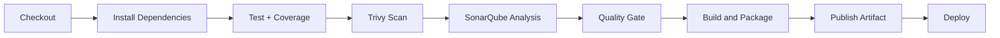

<div align="center">

# Catatan Belajar Ngoding

**Aplikasi pencatat materi dan sesi belajar pemrograman berbasis React, Express.js, dan SQLite dengan CI/CD otomatis**


</div>

---

| Informasi | Keterangan |
|---|---|
| Nama repositori | `ifs24024-pabwe2026-p1` |
| Mata kuliah | Pengembangan Aplikasi Berbasis Web (PABWE) 2026 |
| Jenis tugas | Proyek 1 (individu) |
| Nama mahasiswa | Lyson Paulus Esar Manik |
| NIM | 11S24024 |

---

## Daftar Isi

- [Tautan Penting](#tautan-penting)
- [Tentang Proyek](#tentang-proyek)
- [Fitur Utama](#fitur-utama)
- [Teknologi](#teknologi)
- [Arsitektur Sistem](#arsitektur-sistem)
- [Struktur Proyek](#struktur-proyek)
- [Rute Aplikasi](#rute-aplikasi)
- [Desain Database](#desain-database)
- [Referensi API](#referensi-api)
- [Memulai](#memulai)
- [Konfigurasi Lingkungan](#konfigurasi-lingkungan)
- [Pengujian](#pengujian)
- [CI/CD Pipeline](#cicd-pipeline)
- [Deployment](#deployment)
- [Praktik Terbaik yang Diterapkan](#praktik-terbaik-yang-diterapkan)

---

## Tautan Penting

| Artefak | Tautan |
|---|---|
| Aplikasi (frontend) | `<isi URL aplikasi>` |
| API (backend) | `<isi URL API>` |
| Video YouTube | `<isi URL video>` |
| Hasil pengujian Jenkins | `<isi URL atau lampiran>` |
| Dokumen Proyek 1 | `<isi tautan dokumen>` |

---

## Tentang Proyek

Belajar pemrograman membutuhkan konsistensi. **Catatan Belajar Ngoding** membantu pengguna menjaga konsistensi tersebut dengan menyediakan tempat untuk mencatat materi yang dipelajari (misalnya kursus daring atau buku), mencatat setiap sesi belajar, dan memantau progres melalui status materi serta total menit belajar.

Aplikasi terdiri dari dua bagian yang dipisahkan secara jelas:

- **Backend:** REST API berbasis **Express.js** dengan database **SQLite** yang menyediakan data sendiri.
- **Frontend:** aplikasi **React** (Vite) yang mengonsumsi API tersebut, dengan arsitektur berbasis fitur.

Proyek ini juga menerapkan standar kualitas: pengujian otomatis dengan laporan coverage, analisis statis **SonarQube**, pemindaian keamanan **Trivy**, dan pipeline **Jenkins**.

---

## Fitur Utama

### Manajemen Materi
- Menambah, melihat, mengubah, dan menghapus materi belajar
- Status materi: `belum`, `sedang`, `selesai`
- Pencarian dan penyaringan materi berdasarkan status
- Total menit belajar dihitung otomatis pada setiap materi

### Sesi Belajar
- Mencatat sesi pada materi tertentu (tanggal, durasi dalam menit, catatan)
- Riwayat sesi belajar per materi
- Menghapus sesi belajar

### Antarmuka dan Keandalan
- Validasi form di frontend dan validasi ulang di backend
- Indikator loading dan pesan error yang jelas
- Desain responsif untuk desktop dan perangkat seluler
- Aplikasi bersifat satu pengguna tanpa autentikasi

---

## Teknologi

| Kategori | Teknologi |
|---|---|
| Runtime dan package manager | Node.js 20 LTS, npm |
| Backend | Express.js |
| Database | SQLite (`better-sqlite3`) |
| Frontend | React, Vite, React Router |
| Pengujian | Vitest, Supertest, Testing Library, jsdom, `@vitest/coverage-v8` |
| Kualitas kode | SonarQube |
| Keamanan | Trivy |
| CI/CD | Jenkins, Docker |
| Hosting | Sesuai bagian [Deployment](#deployment) |

---

## Arsitektur Sistem

Frontend tidak mengakses database secara langsung. Seluruh data melalui API.

```
React (frontend)  <--  HTTP / JSON  -->  Express (backend)  <--  SQL  -->  SQLite
```

**Backend:** `Route -> Controller -> Service -> Repository -> Database`

| Lapisan | Tanggung jawab |
|---|---|
| Route | Menentukan endpoint |
| Controller | Menerima request dan mengirim response |
| Service | Aturan bisnis dan validasi |
| Repository | Satu-satunya tempat query SQL |
| Middleware | Penanganan error terpusat dan response seragam |

**Frontend:** `Page -> Hook -> Service -> API Client -> API`

| Lapisan | Tanggung jawab |
|---|---|
| Pages dan Components | Tampilan |
| Hooks | Pengelolaan state dan alur pengambilan data |
| Services | Satu-satunya tempat pemanggilan endpoint |
| Helpers | Pembungkus `fetch` dan penanganan error jaringan |
| Utils | Fungsi murni seperti validasi dan pemformatan |
| Lib | Konstanta konfigurasi terpusat |

---

## Struktur Proyek

```text
ifs24024-pabwe2026-p1/
|-- backend/
|   |-- src/
|   |   |-- config/               # koneksi database dan environment
|   |   |-- controllers/
|   |   |-- services/             # aturan bisnis dan validasi
|   |   |-- repositories/         # query SQL
|   |   |-- routes/
|   |   |-- middlewares/          # penanganan error terpusat
|   |   |-- utils/
|   |   |-- app.js
|   |   `-- server.js
|   |-- tests/
|   |-- vitest.config.js
|   |-- .env.example
|   `-- package.json
|
|-- frontend/
|   |-- src/
|   |   |-- features/
|   |   |   |-- materi/
|   |   |   |   |-- components/   # MateriCard, MateriForm, MateriList
|   |   |   |   |-- hooks/        # useMateri
|   |   |   |   |-- pages/        # MateriListPage, MateriDetailPage
|   |   |   |   `-- services/     # materiService
|   |   |   `-- sesi/
|   |   |       |-- components/   # SesiForm, SesiList
|   |   |       |-- hooks/        # useSesi
|   |   |       `-- services/     # sesiService
|   |   |-- components/
|   |   |   |-- common/           # Button, Loading, ErrorMessage
|   |   |   `-- layout/           # MainLayout, Navbar
|   |   |-- pages/
|   |   |   `-- NotFoundPage.jsx
|   |   |-- helpers/
|   |   |   `-- apiClient.js      # pembungkus fetch
|   |   |-- hooks/
|   |   |   `-- useInput.js       # hook binding form
|   |   |-- lib/
|   |   |   `-- config.js         # konstanta konfigurasi
|   |   |-- utils/
|   |   |   |-- validators.js
|   |   |   `-- formatters.js
|   |   |-- App.jsx               # definisi rute
|   |   |-- main.jsx
|   |   |-- setupTests.js
|   |   `-- test-utils.jsx
|   |-- tests/
|   |-- vitest.config.js
|   |-- .env.example
|   `-- package.json
|
|-- Jenkinsfile                   # definisi pipeline CI/CD
|-- sonar-project.properties
|-- .gitignore
`-- README.md
```

---

## Rute Aplikasi

| Rute | Halaman | Akses |
|---|---|---|
| `/` | Daftar materi | Publik |
| `/materi/:id` | Detail materi dan riwayat sesi belajar | Publik |
| `*` | Halaman tidak ditemukan | Publik |

---

## Desain Database

Satu materi memiliki banyak sesi belajar.

```text
+-----------------+         1        N        +----------------------+
|     materi      | ------------------------> |    sesi_belajar      |
+-----------------+                           +----------------------+
| id (PK)         |                           | id (PK)              |
| judul           |                           | materi_id (FK)       |
| sumber          |                           | tanggal              |
| status          |                           | durasi_menit         |
| created_at      |                           | catatan              |
+-----------------+                           | created_at           |
                                              +----------------------+
```

```sql
CREATE TABLE IF NOT EXISTS materi (
  id          INTEGER PRIMARY KEY AUTOINCREMENT,
  judul       TEXT NOT NULL,
  sumber      TEXT,
  status      TEXT NOT NULL DEFAULT 'belum'
              CHECK (status IN ('belum', 'sedang', 'selesai')),
  created_at  TEXT NOT NULL DEFAULT CURRENT_TIMESTAMP
);

CREATE TABLE IF NOT EXISTS sesi_belajar (
  id            INTEGER PRIMARY KEY AUTOINCREMENT,
  materi_id     INTEGER NOT NULL,
  tanggal       TEXT NOT NULL,
  durasi_menit  INTEGER NOT NULL CHECK (durasi_menit > 0),
  catatan       TEXT,
  created_at    TEXT NOT NULL DEFAULT CURRENT_TIMESTAMP,
  FOREIGN KEY (materi_id) REFERENCES materi(id) ON DELETE CASCADE
);
```

---

## Referensi API

Base URL lokal: `http://localhost:3000/api`

Format response berhasil:

```json
{ "success": true, "message": "Materi berhasil dibuat", "data": {} }
```

Format response gagal:

```json
{ "success": false, "message": "Input tidak valid", "errors": ["judul wajib diisi"] }
```

<details>
<summary><b>Materi</b></summary>

| Method | Endpoint | Deskripsi |
|---|---|---|
| `GET` | `/materi` | Semua materi beserta total menit belajar |
| `GET` | `/materi/:id` | Detail satu materi |
| `POST` | `/materi` | Membuat materi |
| `PUT` | `/materi/:id` | Mengubah materi |
| `DELETE` | `/materi/:id` | Menghapus materi beserta seluruh sesinya |

Contoh body `POST /materi`:

```json
{
  "judul": "JavaScript Dasar",
  "sumber": "SoloLearn",
  "status": "sedang"
}
```

</details>

<details>
<summary><b>Sesi Belajar</b></summary>

| Method | Endpoint | Deskripsi |
|---|---|---|
| `GET` | `/materi/:materiId/sesi` | Semua sesi pada suatu materi |
| `POST` | `/materi/:materiId/sesi` | Menambah sesi belajar |
| `DELETE` | `/sesi/:id` | Menghapus satu sesi |

Contoh body `POST /materi/:materiId/sesi`:

```json
{
  "tanggal": "2026-10-23",
  "durasi_menit": 45,
  "catatan": "Mempelajari perulangan dan fungsi"
}
```

</details>

<details>
<summary><b>Utilitas</b></summary>

| Method | Endpoint | Deskripsi |
|---|---|---|
| `GET` | `/health` | Pemeriksaan status API |

</details>

<details>
<summary><b>Kode status HTTP</b></summary>

| Kode | Arti |
|---|---|
| `200` | Permintaan berhasil |
| `201` | Data berhasil dibuat |
| `400` | Input tidak valid |
| `404` | Data tidak ditemukan |
| `500` | Kesalahan pada server |

</details>

---

## Memulai

### Prasyarat

- Node.js 20 LTS atau lebih baru
- npm
- Git

### Instalasi dan Menjalankan di Lokal

Langkah berikut sesuai dengan alur pada video demonstrasi.

```bash
# 1. Clone repository
git clone https://github.com/<username-github>/ifs24024-pabwe2026-p1.git
cd ifs24024-pabwe2026-p1

# 2. Backend
cd backend
npm install
cp .env.example .env
npm run dev
```

Backend berjalan di `http://localhost:3000`. Database dan tabel dibuat otomatis saat server pertama kali dijalankan.

Buka terminal baru untuk frontend:

```bash
# 3. Frontend
cd frontend
npm install
cp .env.example .env
npm run dev
```

Buka `http://localhost:5173` pada peramban.

### Perintah yang Tersedia

| Lokasi | Perintah | Fungsi |
|---|---|---|
| backend | `npm run dev` | Server mode pengembangan |
| backend | `npm start` | Server untuk produksi |
| backend | `npm test` | Pengujian dengan coverage |
| frontend | `npm run dev` | Server pengembangan Vite |
| frontend | `npm run build` | Build produksi |
| frontend | `npm run preview` | Melihat hasil build secara lokal |
| frontend | `npm test` | Pengujian dengan coverage |

---

## Konfigurasi Lingkungan

Salin `.env.example` menjadi `.env` pada masing-masing folder, lalu sesuaikan nilainya.

**`backend/.env`**

```env
PORT=3000
DB_PATH=./data/catatan.db
CORS_ORIGIN=http://localhost:5173
NODE_ENV=development
```

| Variabel | Deskripsi |
|---|---|
| `PORT` | Port server backend |
| `DB_PATH` | Lokasi berkas SQLite |
| `CORS_ORIGIN` | Alamat frontend yang diizinkan (pisahkan dengan koma bila lebih dari satu) |
| `NODE_ENV` | Mode aplikasi |

**`frontend/.env`**

```env
VITE_API_URL=http://localhost:3000/api
```

| Variabel | Deskripsi |
|---|---|
| `VITE_API_URL` | Alamat dasar API, dibaca terpusat melalui `src/lib/config.js` |

---

## Pengujian

Proyek menggunakan **Vitest** dengan pelaporan coverage berbasis **v8**. Laporan `lcov.info` pada direktori `coverage/` dibaca oleh SonarQube.

```bash
# Backend
cd backend && npm test

# Frontend
cd frontend && npm test
```

### Cakupan Pengujian

| Modul | Berkas Pengujian |
|---|---|
| **Backend API** | `api.test.js` (CRUD materi, sesi belajar, validasi, cascade delete, penanganan error) |
| **Utils dan Helpers** | `validators.test.js`, `formatters.test.js`, `apiClient.test.js` |
| **Services Frontend** | `materiService.test.js`, `sesiService.test.js` |
| **Hooks** | `useInput.test.js`, `useMateri.test.jsx`, `useSesi.test.jsx` |
| **Components** | `MateriForm.test.jsx`, `MateriList.test.jsx`, `SesiForm.test.jsx`, `SesiList.test.jsx` |
| **Pages** | `MateriListPage.test.jsx`, `MateriDetailPage.test.jsx`, `NotFoundPage.test.jsx` |

---

## CI/CD Pipeline

Pipeline didefinisikan pada `Jenkinsfile`. Setiap tahap dijalankan di dalam container Docker yang terisolasi.



### Tahapan Pipeline

| # | Stage | Image | Deskripsi |
|---|---|---|---|
| 1 | **Checkout** | `node:20-alpine` | Mengambil kode sumber dari repositori |
| 2 | **Install Dependencies** | `node:20-alpine` | Menjalankan `npm ci` pada backend dan frontend |
| 3 | **Test** | `node:20-alpine` | Menjalankan pengujian dengan coverage pada backend dan frontend |
| 4 | **Trivy Security Scan** | `aquasec/trivy` | Memindai kerentanan `HIGH` dan `CRITICAL`; build gagal bila ditemukan |
| 5 | **SonarQube Analysis** | `sonarsource/sonar-scanner-cli` | Analisis kualitas kode dan coverage |
| 6 | **Quality Gate** | - | Menunggu hasil Quality Gate; pipeline dihentikan bila gagal |
| 7 | **Build and Package** | `node:20-alpine` | Menjalankan `npm run build` pada frontend dan mengemas aplikasi menjadi arsip zip (tanpa `node_modules`, `.env`, `coverage`, dan berkas data) |
| 8 | **Publish Artifact** | - | Mengarsipkan artifact dan menyediakannya melalui URL publik Jenkins |
| 9 | **Deploy** | `curlimages/curl` | Memicu deployment melalui API, lalu memeriksa status hingga berhasil atau gagal |

### Konfigurasi SonarQube

Berkas `sonar-project.properties`:

```ini
sonar.projectKey=ifs24024-pabwe2026-p1
sonar.projectName=ifs24024-pabwe2026-p1

sonar.sources=backend/src,frontend/src
sonar.tests=backend/tests,frontend/tests
sonar.test.inclusions=**/*.test.js,**/*.test.jsx

sonar.sourceEncoding=UTF-8

sonar.javascript.lcov.reportPaths=backend/coverage/lcov.info,frontend/coverage/lcov.info

sonar.exclusions=**/node_modules/**,**/coverage/**,**/dist/**,**/data/**,frontend/src/setupTests.js,frontend/src/test-utils.jsx
```

### Variabel Lingkungan Jenkins

Pastikan variabel berikut tersedia pada job Jenkins (sebagai environment atau credentials):

| Variabel | Fungsi |
|---|---|
| `URL_REDEPLOY` | Endpoint untuk memicu deployment ulang |
| `URL_PROGRESS` | Endpoint untuk memeriksa progres deployment |
| `DEPLOY_TOKEN` | Token akses deployment |
| `WEBSITE_ID` | ID website target deployment |

Prasyarat tambahan:

- Server SonarQube terdaftar di Jenkins dengan nama `SonarQube`
- Jenkins dan SonarQube berada pada Docker network yang sama
- Docker socket dapat diakses oleh agent Jenkins
- Plugin Jenkins: Docker Pipeline, SonarQube Scanner, Warnings Next Generation, Pipeline Utility Steps

---

## Deployment

Frontend dan backend dijalankan sebagai dua bagian terpisah.

**Melalui pipeline Jenkins**

Tahap **Deploy** pada pipeline memicu deployment otomatis setelah seluruh tahap sebelumnya berhasil, menggunakan variabel `URL_REDEPLOY`, `URL_PROGRESS`, `DEPLOY_TOKEN`, dan `WEBSITE_ID`.

**Manual (alternatif)**

- **Frontend:** layanan hosting statis seperti Vercel, dengan Root Directory `frontend`, preset `Vite`, dan variabel `VITE_API_URL` berisi alamat API yang sudah di-deploy.
- **Backend:** layanan dengan **penyimpanan persisten**, karena SQLite menyimpan data dalam berkas. Variabel yang diatur: `PORT`, `DB_PATH` (mengarah ke disk persisten), `CORS_ORIGIN` (URL frontend), dan `NODE_ENV=production`.## ✨ Fitur Utama

### 🔐 Autentikasi
- Registrasi dan login pengguna dengan validasi formulir
- Penyimpanan token akses di `localStorage` dan bearer token otomatis pada setiap request
- Proteksi rute: pengguna yang sudah login dialihkan dari halaman auth ke dashboard

  ### 📰 Manajemen Postingan
- Linimasa postingan publik dengan tab filter **Postingan Saya** (`is_me=1`)
- Pencarian langsung (*live search*)
- Tambah, ubah, dan hapus postingan
- Unggah atau ganti gambar cover dengan pratinjau (*preview*)
- Like / unlike materi 
- Tambah dan hapus komentar
- Hapus seluruh jawaban milik pengguna

  ### 👤 Pengguna & Profil
- Direktori seluruh pengguna dengan fitur pencarian
- Pembaruan profil (bio), foto avatar, dan kata sandi

  ### 🎨 Antarmuka
- Desain responsif dengan sidebar berbentuk *drawer* di perangkat mobile
- Dialog interaktif menggunakan SweetAlert2
- Tipografi menggunakan Google Fonts
## 🧭 Rute Aplikasi

| Rute | Halaman | Akses |
| --- | --- | --- |
| `/auth/login` | Login | Publik |
| `/auth/register` | Registrasi | Publik |
| `/` | Linimasa postingan | 🔒 Terproteksi |
| `/posts/[postId]` | Detail postingan | 🔒 Terproteksi |
| `/users` | Daftar pengguna | 🔒 Terproteksi |
| `/profile` | Profil saya | 🔒 Terproteksi |

### Tahapan Pipeline

| # | Stage | Image | Deskripsi |
| --- | --- | --- | --- |
| 1 | **Checkout** | `oven/bun:alpine` | Mengambil kode sumber dari SCM |
| 2 | **Install Dependencies** | `oven/bun:alpine` | Menjalankan `bun install` |
| 3 | **Test** | `node:24-alpine` | Menjalankan `vitest run --coverage` |
| 4 | **Trivy Security Scan** | `aquasec/trivy` | Memindai kerentanan `HIGH`/`CRITICAL`; hasil SARIF dilaporkan ke Warnings NG, build gagal bila ditemukan |
| 5 | **SonarQube Analysis** | `sonarsource/sonar-scanner-cli` | Analisis kualitas kode dan coverage |
| 6 | **Quality Gate** | — | Menunggu hasil Quality Gate (timeout 30 menit), pipeline dihentikan bila gagal |
| 7 | **Package Application** | `node:24-alpine` | Membuat `latest-app.zip` (mengecualikan `node_modules`, `.env`, `.next`, `coverage`, dll.) |
| 8 | **Publish Application** | — | Mengarsipkan artifact dan menyalinnya ke Jenkins `userContent` untuk mendapatkan URL publik |
| 9 | **Deploy Application** | `curlimages/curl` | Memicu redeploy melalui API, lalu polling status hingga `SUCCESS` atau `FAIL` (maks. 120 percobaan × 5 detik) |

---


## Praktik Terbaik yang Diterapkan

**Struktur proyek**
- Frontend berbasis fitur (`features/materi`, `features/sesi`), dengan komponen, hook, halaman, dan service berada dalam fitur masing-masing.
- Penamaan konsisten: komponen `PascalCase`, hook diawali `use`, berkas backend memakai sufiks peran (`materi.controller.js`).

**Kode bersih**
- Nama variabel dan fungsi menjelaskan tujuannya.
- Logika berulang diekstrak menjadi fungsi bersama (`utils`, `helpers`).
- Komentar hanya menjelaskan alasan, bukan mengulang isi kode.

**Praktik terbaik**
- Validasi input di frontend dan backend.
- Penanganan error terpusat dengan format response seragam.
- Query SQL memakai parameter terikat untuk mencegah SQL injection.
- Konfigurasi disimpan di environment variable, bukan di kode.
- CORS dibatasi hanya untuk alamat frontend yang diizinkan.
- Pemindaian keamanan Trivy dan Quality Gate SonarQube pada pipeline.

**Pemisahan tanggung jawab**
- Backend: route, controller, service, dan repository masing-masing memiliki satu peran.
- Frontend: komponen hanya menampilkan antarmuka, hook mengelola state, service menjadi satu-satunya pintu ke API, dan fungsi murni dipisahkan ke `utils`.

---

<div align="center">

Dibuat untuk mata kuliah **Pengembangan Aplikasi Berbasis Web (PABWE) 2026**

**Lyson Paulus Esar Manik - 11S24024 - ifs24024**

</div>
